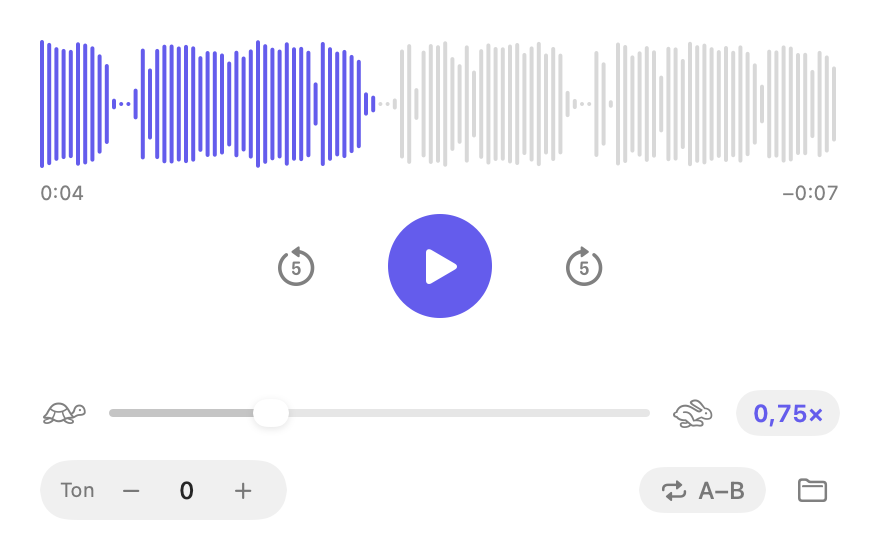
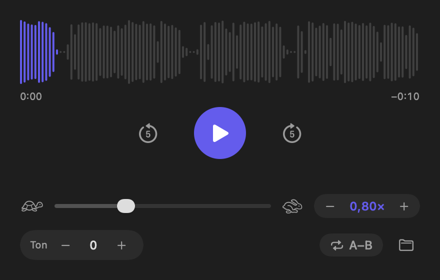

# Tını


Mac için sade ses oynatıcı. Sesi yavaşlatır ya da hızlandırır; ses tonu bozulmaz.

- **Hız** 0,25× – 2×, 0,05 adımlarla (sürgü, − / + düğmeleri ya da listeden 0,50 · 0,55 · … · 1,50 · 1,75 · 2,00)
- **Ton** −12 / +12 yarım ses, hızdan bağımsız
- **A–B döngüsü**: bir bölümü durmadan tekrar et (dil öğrenmek, şarkı çalışmak için)
- Dalga biçimi üzerinde tıklayıp sürükleyerek atlama
- Sürükle-bırak, Finder'da "Birlikte Aç", klavyedeki medya tuşları
- mp3, m4a/aac, wav, aiff, flac, caf

 

## Kısayollar

| Tuş | İş |
|---|---|
| Boşluk | Oynat / duraklat |
| ← → | 5 sn geri / ileri |
| ↑ ↓ | Hız +/− 0,05 |
| 0 | Normal hız |
| L | A–B döngüsü (1. basış başlangıç, 2. basış bitiş, 3. basış kapat) |
| Esc | Döngüyü kapat |
| ⌘O | Dosya aç |

Sağ alttaki süre, **bu hızda** kalan süreyi gösterir; tıklayınca toplam süreye döner.

## Kurulum

```bash
bash kurulum/kur.sh
```

Derler, simgeyi çizer, `/Applications/Tını.app` olarak kurar ve açar. macOS 14 ve üstü, Xcode gerekmez (Komut Satırı Araçları yeter).

---

Powered by [Nüve Dijital](https://nuvedigital.com)
